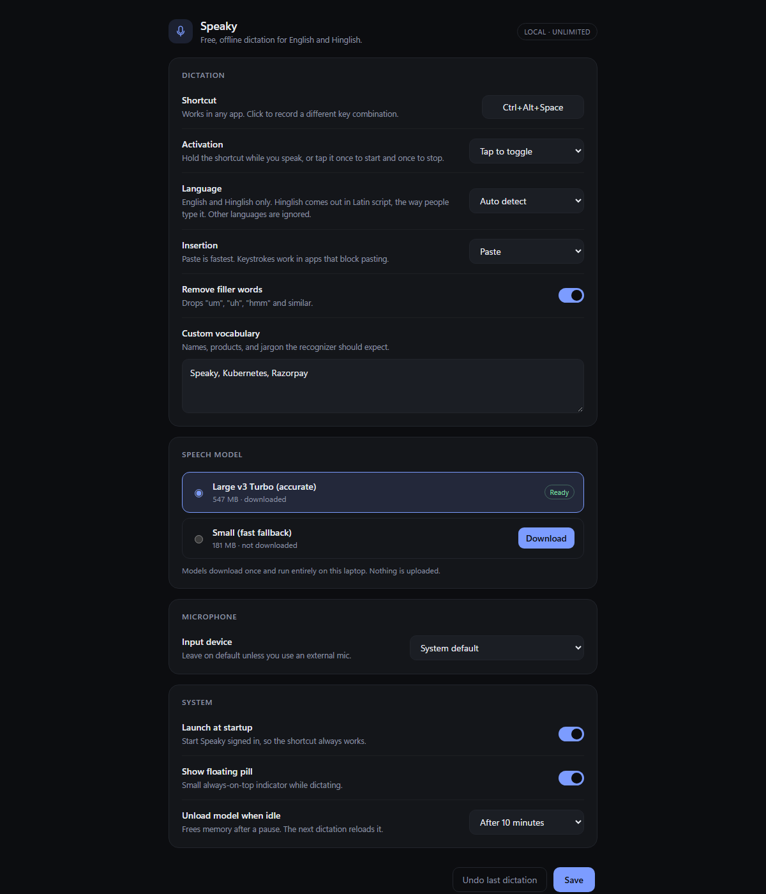
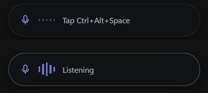

# Speaky

Offline dictation for Windows. Press one shortcut, speak, and the text lands in
whatever app has focus. English and Hinglish, no account, no quota, and no audio
leaving the machine.





## Why

Cloud dictation tools want an account, a subscription, and a copy of your voice.
Speaky runs whisper.cpp locally: the only network traffic is the one-time model
download. After that it works with the network unplugged.

## Features

- **One shortcut, two ways to use it.** *Hold to talk* records while the keys are
  down. *Tap to toggle* starts on a tap and stops on the next one, for hands-free
  takes. The mode is a setting, the shortcut is the same.
- **English and Hinglish.** Hindi speech comes out in Latin script:
  `mujhe kal meeting hai`, never `मुझे कल मीटिंग है`. English loanwords inside a
  Hindi sentence keep their normal spelling. Speech detected as another language
  is ignored, not typed.
- **Text goes where you are typing.** Speaky remembers the focused window when
  you press the shortcut, then pastes or types the transcript into it, even if the
  overlay had focus in between.
- **Filler removal and custom vocabulary.** Drop "um", "uh", and "you know", and
  teach it names or jargon you use often.
- **A small floating pill** shows listening, transcribing, and done states without
  stealing focus. It can be turned off.
- **Tray app.** No main window and no console window; Settings opens on demand.

## Install

1. Download `Speaky-win64.zip` from the [latest release](../../releases/latest).
2. Extract the zip to a folder you keep, for example `C:\Apps\Speaky`.
3. In that folder, run:

   ```powershell
   powershell -ExecutionPolicy Bypass -File install.ps1
   ```

The script copies the app to `%LOCALAPPDATA%\Speaky` and adds a desktop and Start
menu shortcut. It is used instead of an installer package because unsigned
one-file installers are frequently quarantined by Windows Defender as a false
positive; copying the same files does not trigger it.

On first launch, Speaky asks you to download a speech model (about 550 MB). It is
fetched from Hugging Face once and kept in `%LOCALAPPDATA%\Speaky\models`.

### Requirements

- Windows 10 or 11, x64.
- A microphone.
- About 600 MB of disk for the model.
- 4 GB of RAM. The recognizer unloads after ten minutes idle by default.

### Uninstall

```powershell
powershell -ExecutionPolicy Bypass -File install.ps1 -Uninstall
```

That removes the app and shortcuts and keeps the models. Add `-Purge` to delete
the models too.

## Use

Speaky starts in the tray. The default shortcut is `Ctrl+Alt+Space`; change it in
Settings, where the activation style lives as well.

1. Put the cursor where the text should go.
2. Hold the shortcut (or tap it, in toggle mode) and speak.
3. Release, or tap again. The pill says *Transcribing*, then the text appears.

The first take after a pause opens the microphone, which adds about half a second.
The device then stays open for 20 seconds, so follow-up takes start instantly and
include the moment before you pressed the shortcut.

Settings covers the shortcut, activation style, model, language, output method,
microphone, filler removal, vocabulary, overlay, start with Windows, and how long
the model stays loaded.

## How it works

```
shortcut ──► record 16 kHz mono ──► whisper-server (local) ──► Hinglish fix-up ──► type into the focused window
```

- **Capture.** Audio is recorded with WASAPI through `cpal`, downmixed to mono,
  resampled to 16 kHz, trimmed of silence, and level-normalised. A short pre-roll
  buffer is prepended so the first syllable is not lost.
- **Recognition.** `whisper-server.exe` is a child process that loads the model
  once and answers requests on `127.0.0.1`. Keeping it out of process means a
  recognizer crash cannot take the tray app down, and "unload the model" is just
  killing the process. Silero VAD trims silence before decoding.
- **Hinglish.** Whisper often answers Hindi speech in Devanagari. Speaky
  romanizes it with a rule engine (anusvara assimilation, conjuncts, nukta,
  word-final schwa) plus a lexicon for the spellings rules cannot infer
  (`karna`, `mein`, `tumne`), then restores English loanwords that were written
  in Devanagari. A second gate drops any take that whisper identifies as a
  language other than English or Hindi.
- **Insertion.** The transcript is either pasted (fast) or sent as Unicode
  keystrokes (works in apps that block paste). Both target the window that was
  focused when you pressed the shortcut. The last insertion can be undone from the
  tray menu.
- **No console.** Child processes are spawned with `CREATE_NO_WINDOW`, and the app
  itself is built as a GUI binary, so nothing flashes a terminal.

The web layer is plain HTML, CSS, and JavaScript embedded in the executable; there
is no Node runtime and no bundler at runtime.

### Models

| Model | Size | Use |
| --- | --- | --- |
| `large-v3-turbo` q5_0 | 547 MB | Default. Best accuracy on Hinglish. |
| `small` q5_1 | 181 MB | Fallback for slow CPUs. |

Downloads are checked by byte size, so a truncated file is fetched again instead
of being fed to the recognizer. The bundled `whisper-server` uses Vulkan when a
GPU is available and falls back to the CPU otherwise.

## Privacy

- Audio is captured, transcribed, and discarded locally. Nothing is uploaded.
- The only outbound requests are model downloads from Hugging Face, made when you
  click Download.
- Settings live in `%APPDATA%\Speaky\settings.json`, models and the recognizer log
  in `%LOCALAPPDATA%\Speaky`. Delete those folders to remove every trace.

## Limits

- Windows only; the audio, injection, and overlay code is Win32-specific.
- One utterance per request: text arrives when you stop, not while you speak.
- Hinglish output is romanized Latin. Devanagari is not an output option.
- English and Hinglish only. Speech detected as another language is ignored and
  the pill says so.
- A recording stops at five minutes.
- The build is unsigned, so SmartScreen may warn the first time. Choose *More
  info → Run anyway*.

## Licence

MIT.
